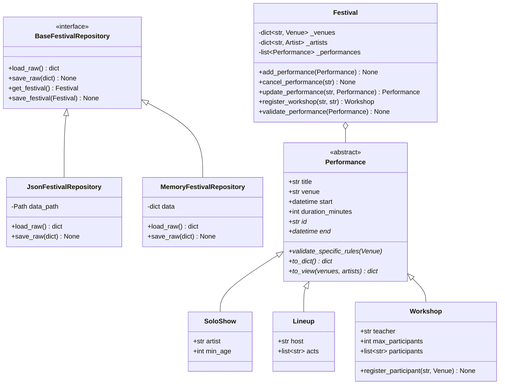

# Deauville Festival du Rire 2027

[](https://www.python.org/)
[](https://fastapi.tiangolo.com/)
[]()
[](https://github.com/astral-sh/ruff)

Management platform and REST API for the **Deauville Festival du Rire** (10–13 June 2027). The system orchestrates festival venues, participating artists, and scheduling rules across multiple performance types (solo shows, lineups, and workshops) through a unified Command-Line Interface (CLI) and a FastAPI web backend.

---

## Table of Contents

- [Overview](#overview)
- [Quick Start](#quick-start)
  - [Prerequisites](#prerequisites)
  - [Installation](#installation)
  - [CLI Usage](#cli-usage)
  - [Running the API Server](#running-the-api-server)
  - [Running the Test Suite](#running-the-test-suite)
- [Architecture & Design](#architecture--design)
  - [Package Layout](#package-layout)
  - [Class Hierarchy & Domain Model](#class-hierarchy--domain-model)
  - [Encapsulation & Immutability](#encapsulation--immutability)
- [Key Questions of the Brief](#key-questions-of-the-brief)
  - [1. Where do the business rules live?](#1-where-do-the-business-rules-live)
  - [2. How do errors communicate which rule failed?](#2-how-do-errors-communicate-which-rule-failed)
  - [3. What would change with a database?](#3-what-would-change-with-a-database)
- [API Contract Summary](#api-contract-summary)
- [Project Status](#project-status)

---

## Overview

The platform coordinates all operational aspects of the 4-day comedy festival:
- **Scheduling Rules**: Enforces 30-minute changeover buffers per venue, prevents double-booking artists across concurrent venues or roles, and observes festival boundary cutoffs (performances before 06:00 belong to the previous festival day).
- **Polymorphism**: Treats Solo Shows, Lineups, and Interactive Workshops as distinct domain entities conforming to a shared `Performance` contract.
- **Pluggable Storage**: Isolates file persistence behind an abstract repository interface (`BaseFestivalRepository`), enabling in-memory testing without filesystem side-effects.

---

## Quick Start

### Prerequisites

- Python `>= 3.12`
- [uv](https://astral.sh/uv/) package manager

### Installation

Clone the repository and synchronize virtual environment dependencies:

```bash
git clone https://github.com/ALOOHA-hub/ECE-Poo-Truck-Project.git
cd ECE-Poo-Truck-Project
uv sync
```

### CLI Usage

The platform provides a unified CLI via the `deauville` command (or `uv run main.py`):

```bash
# Print general festival overview
uv run main.py

# List all venues and total capacity
uv run deauville venues

# View schedule for a specific day
uv run deauville programme 2027-06-11

# Inspect an artist's schedule across festival days
uv run deauville artist max-pellerin

# Check what is currently playing and upcoming at a given moment
uv run deauville now --at 2027-06-11T21:00

# Interactively schedule a new solo show
uv run deauville add

# Cancel a scheduled performance by its unique ID
uv run deauville cancel le-kiosque-2027-06-12-0100
```

### Running the API Server

Launch the web platform backend powered by Uvicorn and FastAPI:

```bash
uv run deauville serve
# or run directly with custom host/port:
uv run uvicorn deauville.api:app --reload --host 127.0.0.1 --port 8000
```

- **Interactive API Documentation (Swagger)**: [http://127.0.0.1:8000/docs](http://127.0.0.1:8000/docs)
- **ReDoc Schema**: [http://127.0.0.1:8000/redoc](http://127.0.0.1:8000/redoc)

### Running the Test Suite

Execute the test suite and verify code compliance:

```bash
# Run all 42 automated tests
uv run pytest -v

# Verify code formatting and linting
uv run ruff check .
uv run ruff format --check .

# Build distributable wheel package
uv build
```

---

## Architecture & Design

### Package Layout

The codebase follows the standard `src/` layout to keep the domain library separate from external scripts and packaging artifacts:

```text
.
├── data/
│   └── festival.json              # Primary JSON dataset (2027 edition)
├── src/
│   └── deauville/
│       ├── api.py                 # FastAPI application factory & routes
│       ├── cli/                   # CLI argument parser and command handlers
│       ├── config/                # Constants, formatting tokens, and enums
│       ├── helpers/               # Pure formatting, time, and slug utilities
│       ├── models/                # Domain models, exceptions, and performances
│       │   ├── performances/      # Performance abstract base, Solo, Lineup, Workshop
│       │   ├── artist.py          # Artist entity
│       │   ├── exceptions.py      # Domain error hierarchy
│       │   ├── festival.py        # Aggregate Root enforcing business rules
│       │   └── venue.py           # Venue entity
│       ├── repositories/          # Storage abstraction (JSON & In-Memory)
│       └── schemas/               # Inbound Pydantic request validation models
├── tests/                         # Pytest contract, rules, and integration tests
├── main.py                        # Root runner script
└── pyproject.toml                 # Package definition, scripts, and build metadata
```

### Class Hierarchy & Domain Model



### Encapsulation & Immutability

1. **Private State**: Collections (`_venues`, `_artists`, `_performances`) inside `Festival` are kept private. Outside consumers access copies or derived views (`venues_by_slug`, `performances_by_id`), preventing untracked external mutation.
2. **Atomic Updates**: Modifications such as `update_performance` validate the complete festival schedule before committing the change. If a rule fails, the schedule remains strictly untouched.
3. **Subtype Invariant Enforcement**: Each performance type encapsulates its own domain validation (e.g. `Lineup` validates minimum act counts and intervals; `Workshop` validates place bounds and prevents duplicate student registrations).

---

## Key Questions of the Brief

### 1. Where do the business rules live?

**All business rules live directly inside the domain model, never in API routes or CLI handlers:**

- **Festival Aggregate Root (`Festival`)**:
  - Enforces the **30-minute buffer rule** between consecutive shows in the same venue.
  - Enforces **artist conflict rules**: an artist cannot be scheduled across overlapping shows (as a solo artist, lineup host, or act) with less than a 30-minute travel/prep buffer.
  - Enforces **festival calendar bounds**: performances must fall between `first_day` and `last_day`.
  - Determines the **festival day cutoff**: shows ending past midnight (up to 06:00) belong to the previous evening.
- **Specific Performance Classes (`SoloShow`, `Lineup`, `Workshop`)**:
  - Lineups enforce at least 2 distinct acts, ensure the host does not perform as an act, and verify total duration covers act transitions.
  - Workshops enforce capacity limits (`min(max_participants, venue.capacity)`) and reject duplicate attendee names.

Because rules are strictly encapsulated within domain methods (`festival.add_performance()`, `workshop.register_participant()`), no caller (CLI, FastAPI, or scripts) can bypass them.

---

### 2. How do errors communicate which rule failed?

The system uses a domain-specific exception hierarchy rooted in `FestivalError`:

```text
Exception
└── FestivalError
    ├── NotFoundError (KeyError, ValueError)      --> HTTP 404 (Entity / file missing)
    ├── ConflictError (ValueError)                 --> HTTP 409 (Buffer clash, double booking)
    └── ValidationError (ValueError)               --> HTTP 422 (Duration bounds, dates, capacities)
        └── InvalidPerformanceTypeError (TypeError) --> HTTP 400 (Workshop operation on Solo show)
```

**Decoupled Error Handling:**
- Domain classes raise meaningful, human-readable exceptions (e.g., `ConflictError("Grand Casino is busy with Tall Tales (20:30-21:50).")`).
- The CLI catches `FestivalError` at its boundary and outputs clean `Error: <reason>` messages with exit code `1` without tracebacks.
- The FastAPI application factory installs a single global exception handler `@app.exception_handler(FestivalError)` that maps each error type to its corresponding HTTP status code (`404`, `409`, `422`, `400`).

---

### 3. What would change with a database?

Thanks to the **Repository Pattern** (`BaseFestivalRepository`), changing the storage mechanism from flat JSON files to a relational database (e.g. PostgreSQL or SQLite using SQLAlchemy / SQLModel) requires **zero changes to the domain models or business logic**:

| Component | With JSON Files (Current) | With Relational Database (Future) |
| :--- | :--- | :--- |
| **Domain Logic** | `Festival`, `SoloShow`, `Lineup`, `Workshop` | **Unchanged** |
| **API & CLI** | Receives `repo: BaseFestivalRepository` | **Unchanged** |
| **Storage Class** | `JsonFestivalRepository` reads/writes `festival.json` | `SqlFestivalRepository` manages DB sessions and queries |
| **Query Strategy** | Entire JSON loaded into memory | SQL queries with filters (`SELECT ... WHERE day = :d`) |
| **Concurrency** | File rewrites (single writer) | Database transactions and row-level locks |

---

## API Contract Summary

| Method | Route | Description | Status Codes |
| :--- | :--- | :--- | :--- |
| `GET` | `/api/festival` | Festival metadata and official date range | `200` |
| `GET` | `/api/venues` | All venues sorted by file order | `200` |
| `GET` | `/api/artists` | All artists sorted alphabetically by slug | `200` |
| `GET` | `/api/artists/{slug}` | Artist details and full performance list | `200`, `404` |
| `GET` | `/api/programme` | Filter schedule by `?day=` and `?venue=` | `200`, `404`, `422` |
| `GET` | `/api/performances/{id}` | Specific performance detail | `200`, `404` |
| `GET` | `/api/now` | What is currently playing and up to 3 upcoming | `200` |
| `POST` | `/api/artists` | Register a new artist | `201`, `409`, `422` |
| `POST` | `/api/performances` | Schedule a new performance | `201`, `409`, `422` |
| `PUT` | `/api/performances/{id}` | Atomically update or reschedule a performance | `200`, `404`, `409`, `422` |
| `DELETE` | `/api/performances/{id}` | Cancel a scheduled performance | `204`, `404` |
| `POST` | `/api/performances/{id}/register` | Register a participant for a workshop | `201`, `400`, `404`, `409`, `422` |

---

## Project Status

- [x] **Step 00–02**: Dataset reading, exploratory questions, and day schedule filtering.
- [x] **Step 03–05**: Functions, commands, time handling, rule verification, and atomic file saving.
- [x] **Step 06–08**: FastAPI integration, OOP modeling, Festival aggregate root, and comprehensive unit testing.
- [x] **Step 09–11**: Polymorphic performance hierarchy (`SoloShow`, `Lineup`, `Workshop`), Admin API, and `src/deauville` package structure.
- [x] **Step 12–13**: Full HTTP API contract adherence (`TestClient`), 0 Ruff errors, complete type annotations, and wheel build verification (`uv build`).
